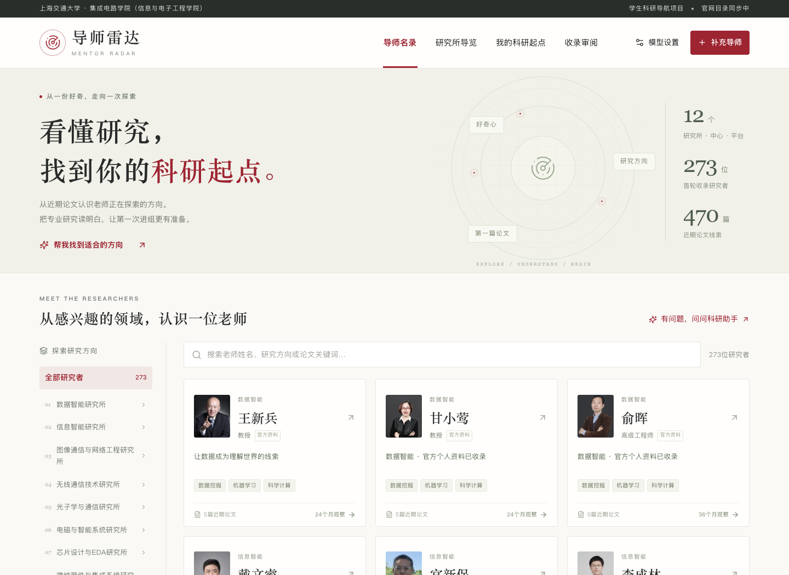
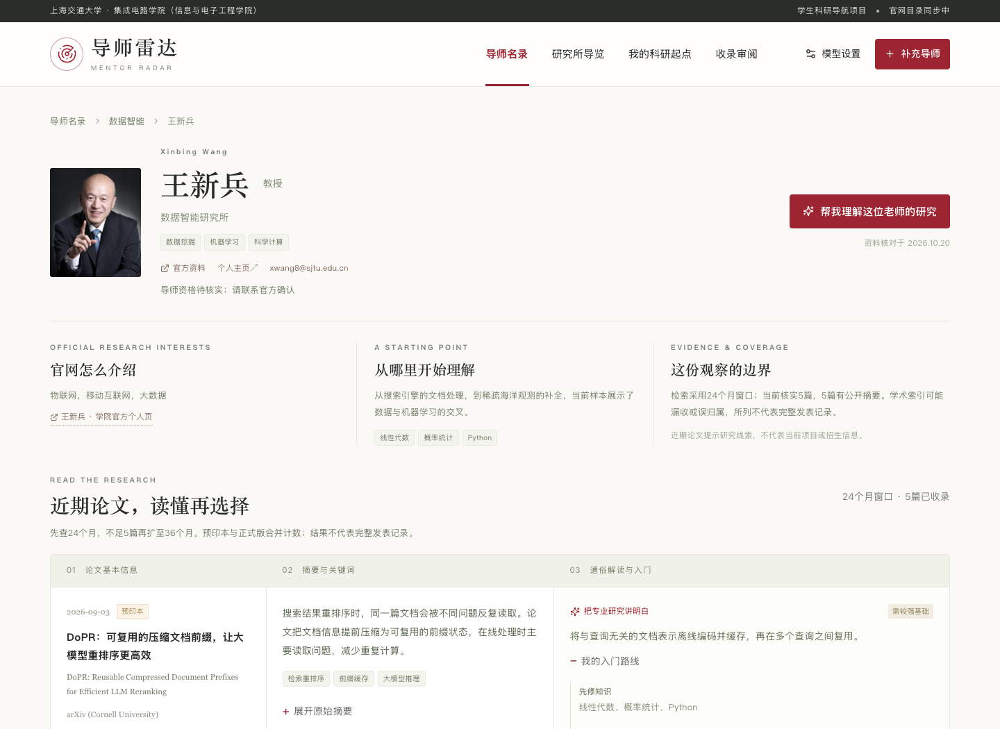
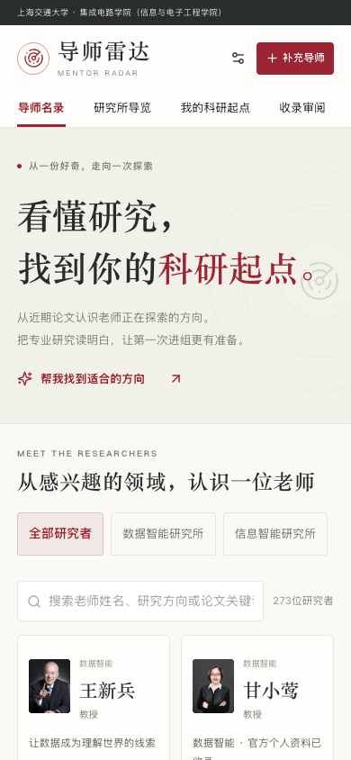
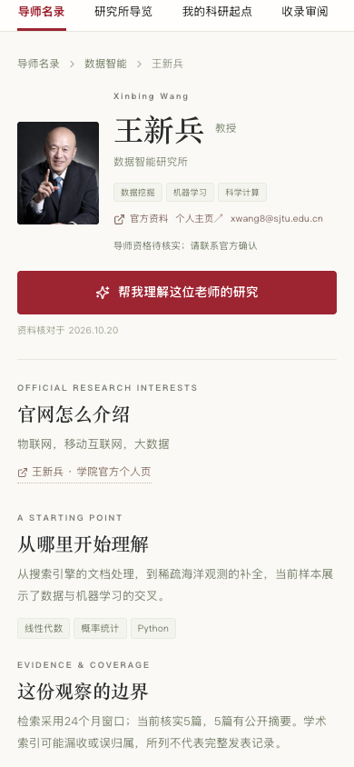

# 效果演示与讲解脚本

## 首页

学院风格的教师目录，展示12个分类、真实照片与近期论文数量。点击左侧研究所筛选，或用姓名、方向、论文关键词搜索。

## 三列论文解读

左列快速确认论文日期、发表位置和状态；中列读中文摘要并查看原始摘要；右列理解方法、先修知识、复现门槛和第一个小任务。

## 手机浏览

机构分类可横向选择，论文三列转为三个纵向区块，保留信息层级。

## 约3分钟现场讲解

|时间|操作|讲解重点|
|---|---|---|
|0:00–0:25|打开首页，查看目录|低年级学生既缺少导师信息，也缺少理解论文的基础；产品把两者连接起来。|
|0:25–0:50|进入一个机构|区分官方背景和样本研究观察；明确只有1位老师的证据不能概括整个机构。|
|0:50–1:30|打开王新兵或戴文睿详情|对比官网概括方向与近期论文，展示三列布局、原始摘要、解读边界和小任务。|
|1:30–2:10|填写“我的科研起点”|输入真实课程和每周时间，解释推荐理由、知识差距与四周成果，而不是给导师排名。|
|2:10–2:35|展示补充导师入口|从公开个人页提取资料，需要核对同名作者、逐篇确认论文；使用自己的Key。|
|2:35–3:00|展示机构简介修订流程或讲解规则|新证据生成前后差异和引用，确认后才生效，可恢复旧版。|

现场模型部分需要事先用个人Key测试学校接口。断网时仍可浏览预置教师、论文解读、机构介绍与审阅表；不要把预置内容或测试模拟结果描述成现场联网模型生成。

## 建议审阅顺序

先检查“收录审阅”的官网目录人员，再抽查12位深度样本的论文作者、日期和解读。特别检查平台人员的角色、缺摘要标记、24／36个月切换，以及机构介绍是否正确保留样本边界。
